# NightFire Xbox – PC Version

A modified version of hk21x's Xbox project with a modernized take of the game: the Xbox version of
**007: NightFire**, statically recompiled to run natively on Windows, with PC controls, modern menus and a set of
quality-of-life features added on top.

> **No game files are included.** You need your own copy of the game (the USA Xbox disc, as an `.iso`). The first
> start compiles the game code from your disc on your own PC.

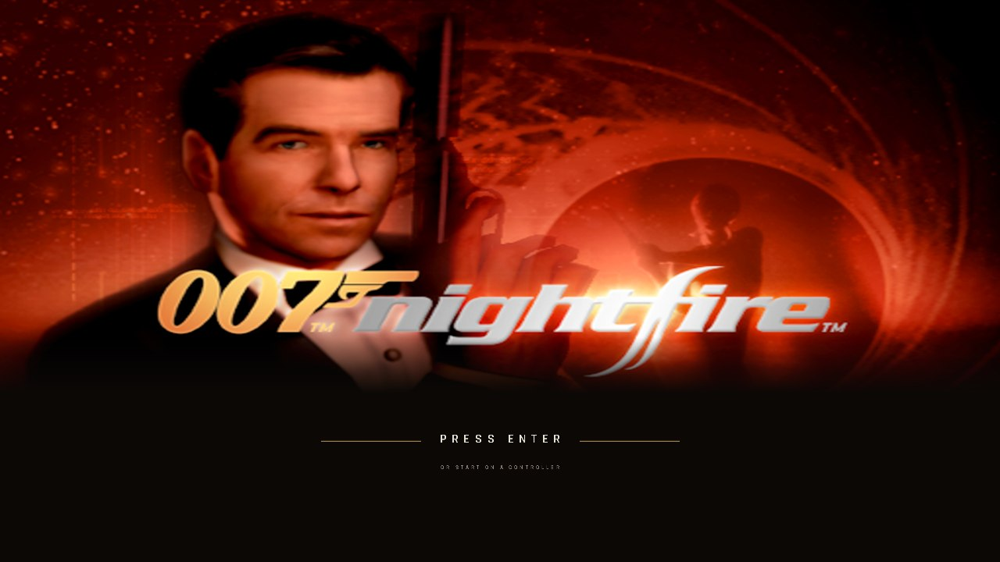

---

## Download and setup

1. Download `NightfireXboxPC-v1.5.zip` from the [Releases](../../releases) page and unzip it anywhere.
2. Put your disc image in the `assets` folder, for example `assets\007 - Nightfire (USA).iso`.
3. Start **`Nightfire Launcher.exe`** (or `Nightfire.exe`).
4. The first start compiles the game code from your disc. This takes a few minutes and happens only once (and again
   after an update). When the window says it is ready, press **Enter**.

**Requirements:** Windows 10 or 11 (64-bit) and a GPU with Direct3D 12. The Visual C++ runtime and the shader
compiler are included in the zip.

---

## Features

### Modern menus
The whole single-player front end and the pause screen are redrawn in a clean, modern style inspired by the PS2 PC
port, and the mouse can point and click everywhere. That covers the title, main menu, codename, difficulty and
mission select, the dossier, the pause screen with all four tabs, the Codenames pages, the mission failed, results
and bonus screens, and the credits. Multiplayer and the driving missions' own menus keep the game's original look.

| Main menu | Mission select |
|---|---|
| 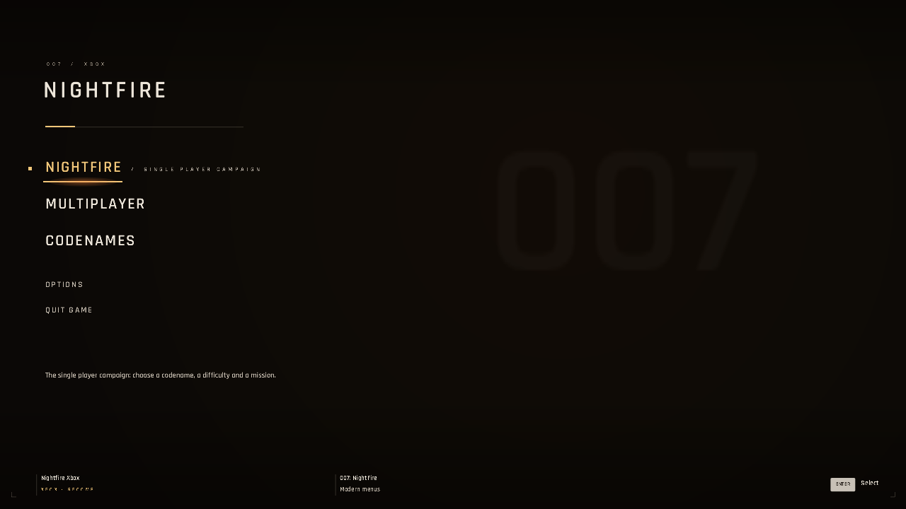 | 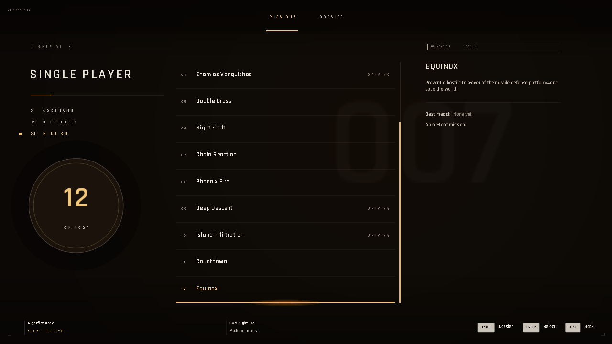 |

| Pause | Objectives |
|---|---|
| 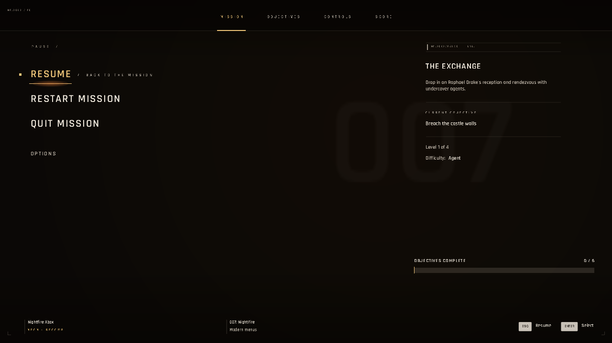 | 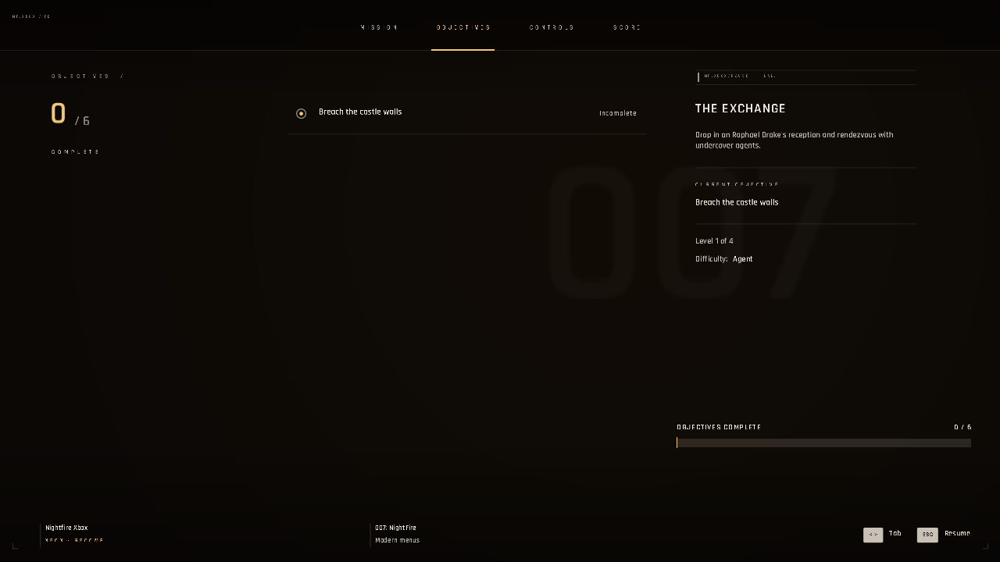 |

| Controls | Mission stats |
|---|---|
| 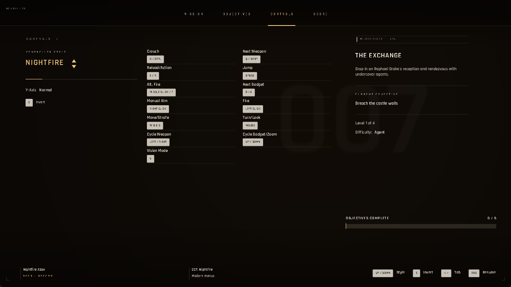 | 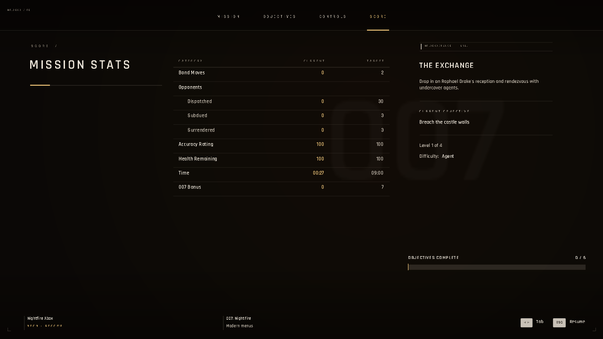 |

### PC Settings in the game
A **PC Settings** page in the main menu and on the pause screen. It covers field of view, mouse sensitivity, invert
mouse, aim down sights, wheel slow motion, skipping the intro movies, sharp text, aspect ratio (including
ultrawide), display mode, resolution, vertical sync and frame cap, plus "Unlock All Codes". More options are in the
launcher and in the F1 settings window.

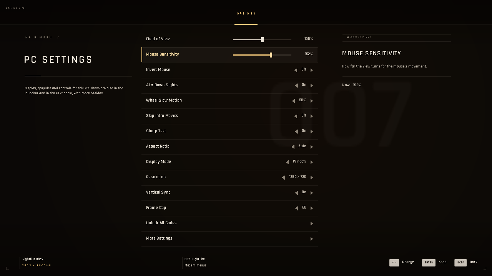

### Weapon wheel (on foot)
Hold **Tab**, point the mouse at a weapon (outer ring) or a gadget (inner ring), and let go to switch. Every slot
shows a picture of its kind, with ammo counts. The game slows down while the wheel is open (Off, 50%, 25% or 10%:
"Wheel slow motion" in the launcher and PC Settings).

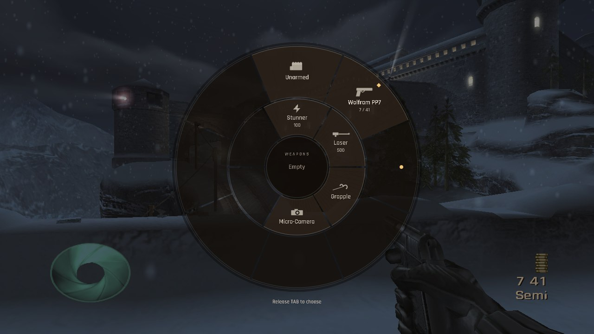

### Weapon wheel in the driving missions
The same wheel works in the vehicles: Tab opens the car's weapons (machine gun, missiles and the rest it has picked
up). It also works on the mounted guns, such as Alpine Escape's snowmobile gun and rockets. Choosing one switches
through the game's own weapon change, so the HUD and sounds stay as they are.

| Car | Snowmobile (mounted gun) |
|---|---|
| 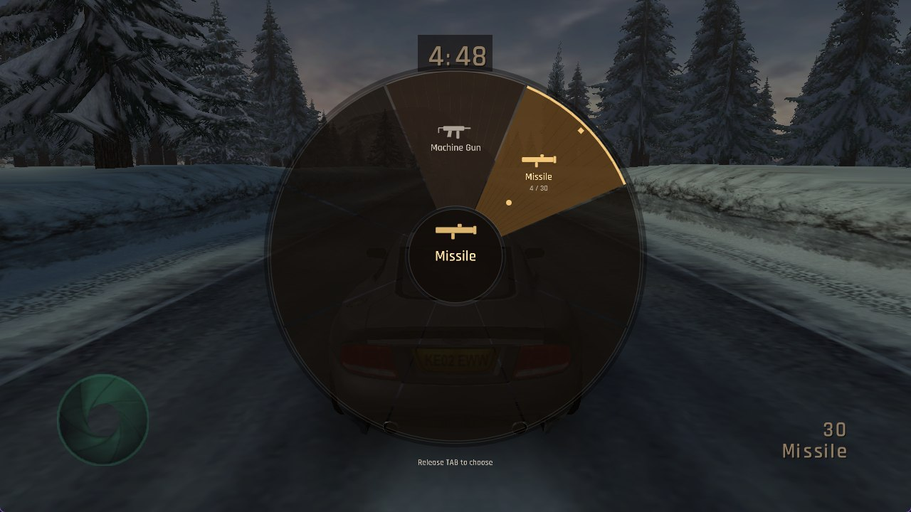 | 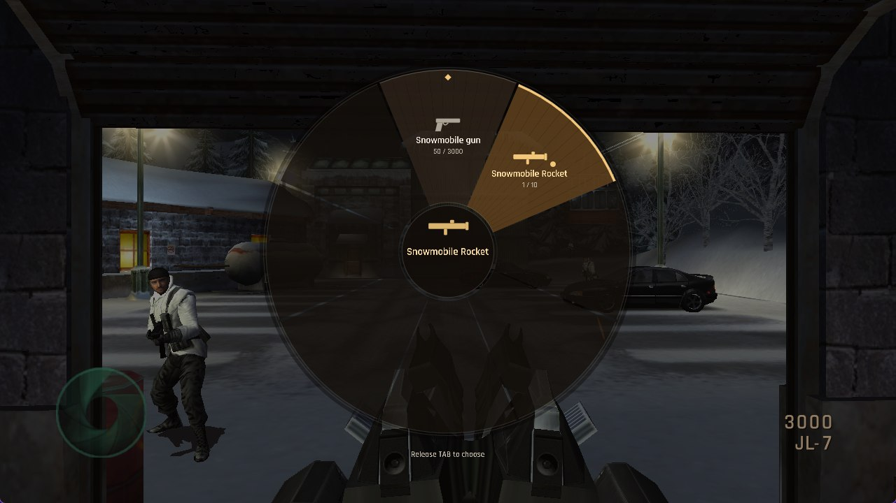 |

### Keyboard and mouse prompts
When you play with the keyboard and mouse, the button pictures show the keys and mouse buttons you actually use.
That includes the menus' help lines, the pause screen's Controls tab, the in-game hints and the driving missions'
hints. With a controller they show a modern Xbox pad instead.

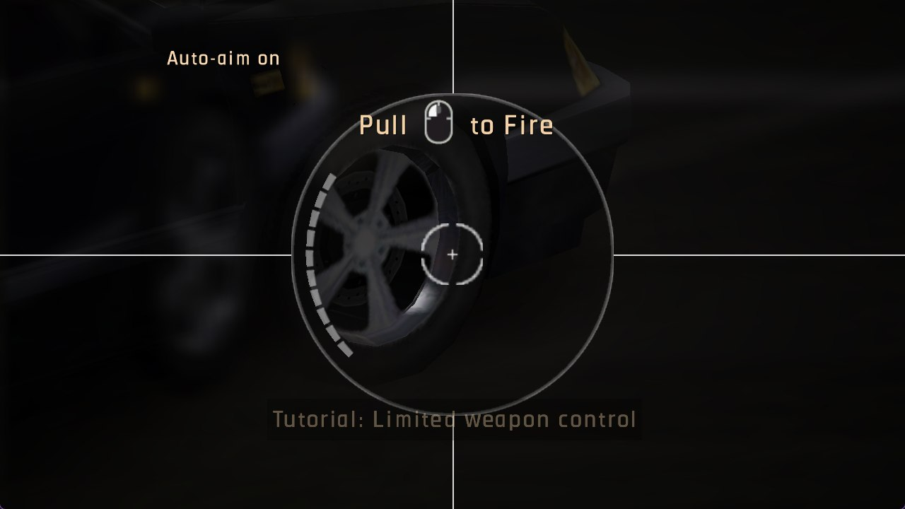

### Mouse aiming like a PC shooter
On foot the mouse turns and aims directly, with no stick acceleration, and the sensitivity is set in PC Settings.
Through a scope the mouse slows down and the mouse wheel zooms. In Equinox's zero-gravity space walk the mouse aims
the same way as everywhere else. On the driving missions' mounted guns the mouse aims, the left button fires and the
right button zooms.

### Aim down sights
Hold the **right mouse button** with a gun that has open sights. The gun comes up to the eye with a slight zoom,
the crosshair hides and the arms move out of the way. It can be switched on or off in the launcher and PC Settings.

### Launcher
`Nightfire Launcher.exe` sets display, graphics and mouse options before you play.

---

## Controls (keyboard and mouse)

| On foot | | Driving | |
|---|---|---|---|
| Move | W A S D | Gas / brake | W / S |
| Look / aim | Mouse | Steer | A / D |
| Fire | Left mouse button | Fire | Left mouse button |
| Aim (manual / sights) | Right mouse button | Gadget | Right mouse button, E |
| Jump | Space | Handbrake | Space |
| Crouch | C, Ctrl | Next / previous weapon | Q / Z, mouse wheel |
| Action / reload | E, R | Camera | C |
| Next weapon | Q, mouse wheel | Look back | V, middle mouse button |
| Next gadget | G, 2 | Weapon wheel | Tab |
| Alt. fire | Middle mouse button, F | Pause | Esc, P |
| Vision mode | V | | |
| Weapon wheel | Tab | | |
| Pause | Esc, P | | |

All keys can be changed in the F1 window.

---

## Changes in v1.5
See [CHANGELOG.md](CHANGELOG.md). Highlights:
- The driving missions' hints show PC keys ("Pull [left mouse button] to Fire").
- Equinox: firing the Phoenix Samurai no longer pushes Bond down through the floor.
- Equinox: the mouse aims in zero gravity the same as in the rest of the game.
- The weapon wheel works on the driving missions' mounted guns.
- PC Settings opened from the pause screen: the arrows change the values again.

---

## Credits and license
- Based on TGP482's Xbox project: nightfire-recomp, the static recompilation of the Xbox version, built on the
  XboxXBE-Recomp toolkit. Its licence is in [`licenses/nightfire-recomp-LICENSE.txt`](licenses/nightfire-recomp-LICENSE.txt).
- Third-party parts of the toolkit: [`licenses/THIRD_PARTY.txt`](licenses/THIRD_PARTY.txt).
- Menu font: Rajdhani (SIL Open Font License): [`licenses/Rajdhani-OFL.txt`](licenses/Rajdhani-OFL.txt).
- This repository: [MIT](LICENSE).

007 and NightFire are trademarks of their respective owners. This is a fan project, not affiliated with or endorsed
by them, and it contains no game data.
